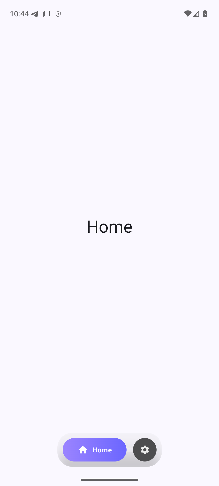
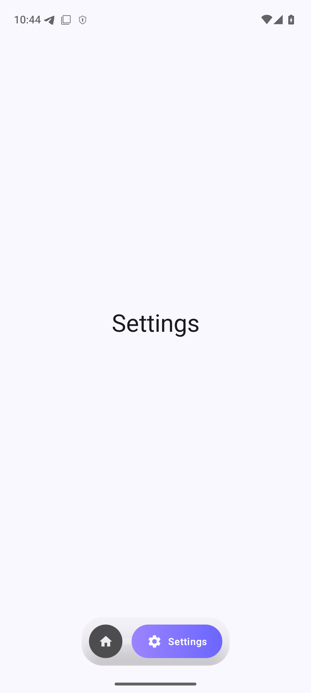

<!--
SPDX-FileCopyrightText: 2026 Saalim Quadri <danascape@gmail.com>
SPDX-License-Identifier: Apache-2.0
-->

# Pvot Design System

A Jetpack Compose design system library for building consistent Android applications.

[](https://reports.exodus-privacy.eu.org/en/reports/com.prauga.pvot/latest/)

<p align="center">
  
  
</p>

## Project Structure

```
PvotLib/
├── build-logic/      # Convention plugins: SDK levels, Compose
├── catalog/          # Catalog app demonstrating components
├── core-ui/          # UiState and loading/error/empty content (com.prauga.pvot.coreui)
├── design-system-views/  # PvotTheme for XML layouts and Material Components (com.prauga.pvot.designsystem.views)
├── design-system/    # Reusable library module
│   └── src/main/java/com/prauga/pvot/designsystem/
│       ├── theme/        # PvotAppTheme, PvotTheme, colors, type
│       ├── effects/      # pvotPressScale
│       ├── motion/       # PvotMotion, pvotReveal
│       ├── components/   # PvotCard, PvotScreen, PvotSkeleton
│       │   └── picker/   # PvotClockPicker, PvotDurationPicker
│       ├── navigation/   # PvotNavBar
│       └── platform/     # PvotBaseActivity
└── gradle/
    └── libs.versions.toml
```

## Installation

PvotLib is published from this repository; no account or token is needed to use it.

**From the Maven repository (recommended).** Add the repository in `settings.gradle.kts`:

```kotlin
dependencyResolutionManagement {
    repositories {
        google()
        mavenCentral()
        maven("https://pvot-oss.github.io/PvotLib/maven") {
            content { includeGroup("com.prauga.pvot") }
        }
    }
}
```

then the libraries, for example through the version catalog:

```toml
[versions]
pvot = "1.0.0"

[libraries]
pvot-design-system = { group = "com.prauga.pvot", name = "design-system", version.ref = "pvot" }
pvot-core-ui = { group = "com.prauga.pvot", name = "core-ui", version.ref = "pvot" }
pvot-design-system-views = { group = "com.prauga.pvot", name = "design-system-views", version.ref = "pvot" }
```

```kotlin
// app/build.gradle.kts
dependencies {
    implementation(libs.pvot.design.system)
    implementation(libs.pvot.core.ui)
}
```

Compose UI, Material 3 and Activity Compose come with them. `design-system-views` is for apps with
XML layouts: it brings Material Components for Android and `PvotTheme`, with no Compose dependency
(see GUIDE section 9).

**As an AAR.** Each [release](https://github.com/PVOT-OSS/PvotLib/releases) has
`design-system-<version>.aar`, `core-ui-<version>.aar` and `design-system-views-<version>.aar` attached. A bare AAR doesn't bring its
dependencies, so also add the Compose BOM, `androidx.compose.ui:ui`, `ui-graphics`, `material3` and
`androidx.activity:activity-compose`.

**From source.** Include the modules in a multi-module project:

```kotlin
// settings.gradle.kts
include(":design-system")

// app/build.gradle.kts
dependencies {
    implementation(project(":design-system"))
}
```

**In AOSP.** Both libraries build inline as `PvotDesignSystem` and `PvotCoreUi` (`Android.bp`).

The full reference (tokens, motion, components and the rules for library code) is in
**[docs/GUIDE.md](docs/GUIDE.md)**.

## Quick Start

Wrap your app with `PvotAppTheme`:

```kotlin
class MainActivity : ComponentActivity() {
    override fun onCreate(savedInstanceState: Bundle?) {
        super.onCreate(savedInstanceState)
        setContent {
            PvotAppTheme {
                // Your app content
            }
        }
    }
}
```

## Theme

### PvotAppTheme

The main theme composable: Material 3 with the Pvot palette or, when enabled and supported,
the platform's dynamic colors.

```kotlin
@Composable
fun PvotAppTheme(
    darkTheme: Boolean = isSystemInDarkTheme(),
    dynamicColor: Boolean = false,
    colorScheme: ColorScheme = PvotThemeDefaults.colorScheme(darkTheme, dynamicColor),
    typography: Typography = PvotTypography,
    content: @Composable () -> Unit
)
```

### Accessing Theme Colors

```kotlin
MaterialTheme.colorScheme.primary
PvotTheme.isDynamicColor
```

### Component Colors

Each component derives its colors from the theme through its `*Defaults` object, and takes a
`colors` parameter to override them:

```kotlin
PvotNavBarDefaults.themeColors()   // derived from the color scheme (light, dark and dynamic)
PvotNavBarDefaults.colors(containerColor = Color.DarkGray)
PvotPickerDefaults.themeColors()   // derived from the color scheme

PvotNavBar(
    selectedTab = selectedTab,
    onTabClick = { selectedTab = it },
    tabs = tabs,
    colors = PvotNavBarDefaults.colors(
        gradient = Brush.horizontalGradient(listOf(Color.Red, Color.Magenta))
    )
)
```

Nav bar sizes are shared with `PvotScreen` through `LocalPvotNavBarSizes`:

```kotlin
CompositionLocalProvider(LocalPvotNavBarSizes provides PvotNavBarSizes(barHeight = 64.dp)) {
    // PvotNavBar and PvotScreen
}
```

## Components

### PvotNavBar

A floating bottom navigation bar: bare icons, with the selected one opening into a filled pill. Drag a finger along the bar to preview items, and lift to select.

```kotlin
@Composable
fun PvotNavBar(
    selectedTab: Int,
    onTabClick: (Int) -> Unit,
    tabs: List<PvotTabItem>,
    modifier: Modifier = Modifier,
    @DrawableRes expandedIconRes: Int? = null,
    @StringRes expandedContentDescriptionRes: Int? = null,
    sizes: PvotNavBarSizes = LocalPvotNavBarSizes.current,
    colors: PvotNavBarColors = PvotNavBarDefaults.themeColors(),
)
```

#### Usage

```kotlin
var selectedTab by remember { mutableIntStateOf(0) }

val tabs = listOf(
    PvotTabItem(
        iconRes = R.drawable.ic_home,
        labelRes = R.string.tab_home,
        contentDescriptionRes = R.string.cd_home
    ),
    PvotTabItem(
        iconRes = R.drawable.ic_settings,
        labelRes = R.string.tab_settings,
        contentDescriptionRes = R.string.cd_settings
    )
)

Scaffold(
    bottomBar = {
        PvotNavBar(
            selectedTab = selectedTab,
            onTabClick = { selectedTab = it },
            tabs = tabs
        )
    }
) { padding ->
    // Screen content
}
```

#### Features

- Smooth, eased pill opening and closing, with no overshoot
- Drag along the bar to land on any item, with haptic ticks
- Press feedback on every item
- Handles navigation bar padding automatically
- Fully customizable colors via theme or parameters

### PvotClockPicker

A wheel-based time picker for selecting a time of day.

```kotlin
@Composable
fun PvotClockPicker(
    time: LocalTime,
    onTimeChange: (LocalTime) -> Unit,
    modifier: Modifier = Modifier,
    colors: PvotPickerColors = PvotPickerDefaults.themeColors()
)
```

#### Usage

```kotlin
var selectedTime by remember { mutableStateOf(LocalTime.of(0, 0)) }

PvotClockPicker(
    time = selectedTime,
    onTimeChange = { selectedTime = it }
)
```

#### Features

- Clean domain-focused API using `java.time.LocalTime`
- Smooth wheel scrolling with snap behavior
- Adapts to light/dark theme automatically
- No implementation details exposed (no LazyColumn, itemHeight, etc.)

### PvotDurationPicker

A wheel-based picker for selecting a time duration.

```kotlin
@Composable
fun PvotDurationPicker(
    duration: Duration,
    onDurationChange: (Duration) -> Unit,
    modifier: Modifier = Modifier,
    colors: PvotPickerColors = PvotPickerDefaults.themeColors()
)
```

#### Usage

```kotlin
import kotlin.time.Duration.Companion.minutes

var selectedDuration by remember { mutableStateOf(30.minutes) }

PvotDurationPicker(
    duration = selectedDuration,
    onDurationChange = { selectedDuration = it }
)
```

#### Features

- Clean domain-focused API using `kotlin.time.Duration`
- Hours, minutes, and seconds wheels
- Smooth wheel scrolling with snap behavior
- Adapts to light/dark theme automatically

## Releasing

1. Set `version` in `gradle.properties`, and turn the changelog's "unreleased" heading into that
   version's date.
2. Commit, then tag and push: `git tag v1.0.0 && git push origin v1.0.0`.

The release workflow checks the tag matches the version, builds and tests, adds both libraries to
the Maven repository on GitHub Pages (never overwriting a released version), and creates a GitHub
Release with the AARs, their sources and the catalog APK.

## Roadmap

### Components (Planned)

| Component | Description | Status |
|-----------|-------------|--------|
| PvotNavBar | Floating bottom navigation | Done |
| PvotSlider | Minimal slider, with a range variant | Done |
| PvotClockPicker | Wheel-based time picker | Done |
| PvotDurationPicker | Wheel-based duration picker | Done |
| PvotTopBar | Top bar whose large title folds in on scroll | Done |
| PvotCard | Styled card with elevation variants | Done |
| PvotGlassCard / PvotGlassIconButton / PvotGlassSurface | Glass over a backdrop, and the recipe to build your own | Done |
| PvotScreenScaffold | The frame of a glass screen: backdrop, background, bars and overlays | Done |
| PvotPhotoBackground (+ PvotLiveBackground / PvotGradientBackground for demos) | A blurred photo behind glass, such as a caller's | Done |
| PvotCallButton / PvotCallActionButton | In-call toggles with labels, and the solid answer, decline and end buttons | Done |
| PvotKeypad / PvotKeypadDisplay | Phone keypad reporting down and up, and the number with a backspace | Done |
| PvotAvatar | A person's photo or letter tile, with a ring and a badge | Done |
| PvotAvatarStack | Overlapping avatars with a "+n" count | Done |
| PvotDateHeader / PvotDayStrip / PvotEventCard | Agenda pieces: date hero, day picker strip, event card | Done |
| PvotShutterButton / PvotZoomSelector / PvotModeSelector / PvotControlPanel / PvotAdjustmentSheet | Camera controls on glass over a live preview | Done |
| PvotSlideToAct | Slide up or down to act, as answering a call | Done |
| PvotCapsule | A glass pill grouping floating controls | Done |
| PvotTabRow | Text tabs with a sliding underline | Done |
| PvotIconButton | Round icon buttons and toggles | Done |
| PvotListGroup | Rows grouped on one card with dividers | Done |
| PvotLinearProgress / PvotProportionBar | A seekable progress bar and a bar of shares in one hue | Done |
| PvotButton | Filled, tonal, text and destructive buttons | Done |
| PvotTextField | Floating-label text field | Done |
| PvotDialog | Animated modal dialogs | Done |
| PvotDialogContent | A dialog's card on its own, for a window the app already has | Done |
| PvotChip | Filter and action chips | Planned |
| PvotListRow | List rows, letter tiles and swipe actions (`PvotSwipeRow`) | Done |
| PvotFastScroller | Jump through a long sectioned list, such as contacts by letter | Done |
| PvotSwitchRow / PvotPreferenceRow | Settings rows | Done |
| PvotSegmentedControl | Segmented control with a sliding pill | Done |
| PvotSnackbarHost | Snackbars with Undo | Done |
| PvotFab | Floating action button, round or extended | Done |
| PvotBottomSheet | Bottom sheet with drag handle | Done |
| PvotTheme (XML) | Material Components theme and tokens for View-based apps (`design-system-views`) | Done |

### Theme (Plans)

- Custom font integration
- Dark/Light mode previews
- Color palette generator
- ~~Semantic color tokens (success, warning)~~ Done: `PvotTheme.extendedColors`
- Motion/animation tokens
- Spacing scale tokens

### Tooling (Plans)

- Compose Preview catalog
- Snapshot testing setup

## License

Apache License 2.0
